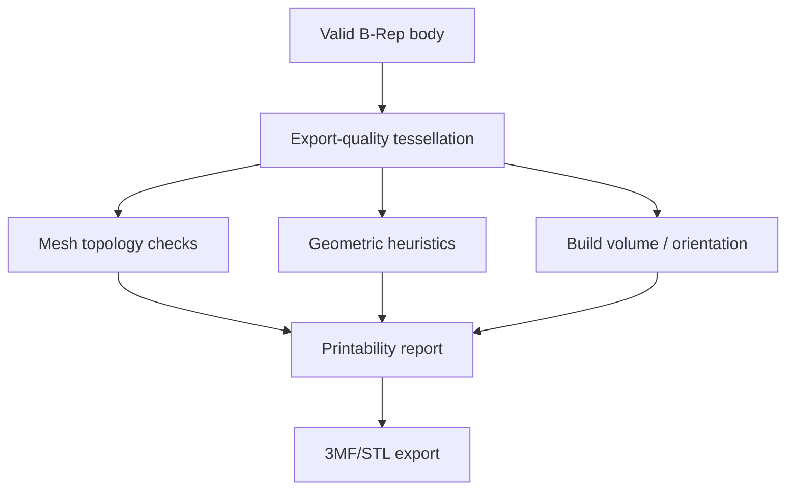

# 3D-printing workflow

## Recommendation

VibeShape owns **modeling, validation, and high-quality exchange**. A slicer owns manufacturing toolpaths. The primary v1 output is 3MF; STEP is the exact CAD exchange format, and STL is retained for compatibility.

A built-in slicer is outside the MVP. PrusaSlicer/libslic3r and CuraEngine are large standalone AGPL C++ projects with complex printer-profile systems. Porting and maintaining them in a browser must not block CAD development.

## Export mesh quality

The model export dialog, assembly export and **Prepare print** provide **Default**, **Coarse**
and **Fine** tessellation choices. Coarse uses `0.2 mm` absolute chord tolerance and `0.3 rad`
angular deflection; Fine uses `0.01 mm` and `0.05 rad`. Default preserves existing behavior:
ordinary STL uses `0.05 mm / 0.1 rad`, document 3MF/print copies use `0.02 mm / 0.1 rad`,
and assembly exports use their captured mesh policy. Quality controls exact-solid triangulation,
including mixed exact/mesh selections; imported meshes retain their original triangles.
Smaller tolerances increase mesh detail and file size. Existing export and print budgets still
apply. STEP preserves exact geometry and does not accept tessellation quality.

The Thread panel includes coarse metric nominal diameter/pitch presets from M2 to M24, based on
[published fastener diameter/pitch data](https://www.advancedynamicsolution.com/resources/metric-thread-data.html).
Selecting a preset sets only nominal diameter and pitch. Groove depth, radial clearance, length,
starts, axis, handedness and allowances remain authored values and keep ordinary validation.
Editing either dimension returns the selector to **Custom dimensions** without altering the
other fields. The existing 60-degree V-groove geometry is a custom thread; a preset does not
establish an ISO profile, gauge tolerance class or certified standard fit.

## Printer profile

The implemented local profile contains a name, version, rectangular width/depth/height in
millimeters, and an XY edge margin. Configure it in **Settings → Printer build volume**. The example
dimensions are illustrative, not a verified printer preset. Legacy viewer preferences keep their
existing theme, export choice, and sketch visibility when the new optional fields are absent.

The viewport can display an XY ground grid independently of a printer. Enabling the printer bed
adds a centered XY rectangle and a height envelope from Z=0. These decorations are excluded from
picking, modeling history, geometry exports, and document authority. The main viewport checks the
current CAD coordinates, including visible disposable previews; it does not silently move the model.

**Prepare print** rotates a disposable export-quality copy around X, Y, and Z, centers it on XY, and
seats its lowest point on Z=0. Optional experimental breakaway fins remain separately controlled.
Select a body triangle in the prepared preview and choose **Lay selected face on bed** to orient
its outward normal down, reset Z rotation, and regenerate the print copy. This facet selection is
disposable and does not become a persisted CAD topology reference.
The same build-volume check evaluates all prepared meshes, including generated fins. It reports
each exceeded lower or upper boundary and the overrun in millimeters, plus combined and per-mesh
bounds. A fit verdict tolerates at most `1e-6 mm` numerical error and preserves unrounded bounds.
The bounded analysis accepts at most ten meshes and 104,000 triangles including supports; unsupported
display models report an unavailable check rather than a successful fit.

This is a tessellation-based check of the **current orientation**. An overflow does not prove that no
other orientation fits, and a fit does not prove successful printing. Slicer-generated supports,
brim, exclusion zones, collision clearance, and machine-specific restrictions still need slicer
verification. Circular beds and the richer profile fields below remain planned.

The extended CAD-analysis profile is intended to contain:

- build volume X/Y/Z;
- rectangular or circular bed shape;
- nozzle diameter or diameters;
- nominal layer height;
- FDM/FFF or resin process;
- material family and user-defined design rules;
- recommended minimum wall, hole, and clearance;
- overhang warning angle;
- shrinkage and fit notes;
- profile name, source, and version.

It is not a complete slicer profile. Temperatures, speeds, acceleration, and G-code scripts are outside alpha.

## Print Check pipeline



### Required P0 checks

- document and export units;
- B-Rep validity and solid existence;
- non-zero volume;
- closed and manifold mesh;
- degenerate triangles, NaN/Infinity, and zero-area faces;
- consistent triangle orientation;
- disconnected shells or components;
- bounding box and fit within the build volume;
- estimated triangle count and file size;
- selected tessellation tolerance;
- parts below or above the build plate after placement.

### P1 heuristics

- overhang heatmap relative to build direction;
- bridge candidates;
- thin-wall approximation using sampling, ray casting, or an SDF strategy;
- minimum hole, slot, and embossed-feature warnings;
- coarse unsupported-island analysis by layer;
- clearance and interference between bodies;
- orientation suggestions based on contact area, height, overhang, and a support proxy;
- enclosed-void and resin-drain warnings where they can be determined reliably.

Every result includes:

- severity: `info`, `warning`, or `error`;
- geometry selection or overlay;
- rule and threshold;
- confidence and method limitation;
- suggestion, without destructive automatic repair by default.

## Design rules and tolerances

There are no universal correct numbers. Results depend on printer, material, orientation, calibration, and process.

The application provides:

- conservative starter presets explicitly labeled as recommendations;
- user calibration values;
- per-document overrides;
- fit intent: loose, sliding, press, or custom;
- the selected clearance as an explicit model parameter;
- a warning that compensation requires validation with a test print.

## 3MF

3MF is a ZIP/XML format with defined units, meshes, components and transforms, metadata, and extensions. v1 supports a minimal interoperable profile:

- Core mesh;
- `millimeter` units;
- multiple objects and components;
- build items and transforms;
- base color or material labels when supported correctly;
- thumbnail and application metadata;
- no vendor-specific slicer settings in the first release.

The writer must:

- follow OPC package and relationship structure;
- emit valid XML without external entities;
- use UTF-8;
- use unique resource IDs;
- write only finite coordinates;
- pass official conformance samples or validation where available;
- open in at least two independent slicers in release smoke tests.

Valid enclosed cavities use inward-oriented nested shells. Export checks real containment,
intersection, alternating winding, and positive total material volume rather than requiring each
surface shell to have positive volume. Public import counts canonical Core vertex/triangle leaves
against existing aggregate geometry limits; other XML nodes retain their separate 100,000-node
limit. See [lightweighting exchange bounds](product/lightweighting.md#quick-runtime-and-exchange-bounds).

Do not promise portability of slicer profiles between vendors; metadata and extensions differ.

SPK-004 selects a deterministic project-owned Core writer using `fflate`. Its local-only gate verifies the same two-mesh component fixture through PrusaSlicer and the Orca/Bambu family and requires matching facet, manifold, and volume metrics. See [SPK-004 evidence](spikes/spk-004-3mf.md).

The product dialog exports successful terminal exact B-Rep bodies through the print-mesh path. The geometry worker retessellates each body with a fixed `0.02 mm` chord tolerance and `0.1 rad` angular tolerance, clears the temporary OCCT triangulation after extraction, and returns bounded triangle soups. The document worker verifies body identity and order, welds face-local duplicate vertices at `1e-7 mm`, and validates the resulting manifold mesh through the Core writer.

Export scope selects all current terminal bodies or one available authored part. Display-hidden parts remain
exportable; stale or unavailable selections fail instead of substituting another cached shape. Authored names
label their 3MF mesh resources, with feature labels as the unmanaged-body fallback. Multiple meshes share one
component build item that retains their world positions; slicers may offer their own grouping or rearrangement
controls. Selected STL and STEP use the same exact semantic body selection. Export does not change the model.

The current prepared-print slice adds a disposable derived copy from **Export → Prepare print /
breakaway fins**. It rotates around X/Y, centers the copy over the XY build area, seats its lowest
point at Z=0, and can add at most two coplanar disjoint comb-prism fins to selected sloped planar
facets. Fin contacts are aligned to the requested layer height and the prepared export contains one
3MF build item with model and fin components. The prepared file can be downloaded or sent through the
same paired slicer handoff; it does not mutate CAD history or design coordinates, and closing or
cancelling the preparation terminates its disposable worker operation.

The support heuristic is intentionally bounded: it accepts one validated convex closed body only.
Multiple bodies, non-convex or open meshes, and complexity or contact-limit cases retain the
transformed model in the analysis result, add no fins, and return an explicit warning. Export still
requires the normal 3MF manifold validation; an invalid open source is not made exportable by a
warning. Even supported cases always report
`partial-coverage`; full overhang coverage is not assured. Independent local evidence confirms that
the generated body and fin components are manifold and positive-volume in PrusaSlicer `--info`, and
that a Bambu Studio `--info` inspection reports the expected 84 facets, 3 parts, manifold status, and
`20 x 28.942136 x 28.284271` bounds for the checked fixture. These checks are format/mesh evidence
only: they do not establish successful slicing, toolpaths, or a physical print.

Materials, colors, vendor settings, graphical face-on-bed placement, printer/build-volume profiles,
overhang analysis, persistent print setups, progress reports, and hostile 3MF import remain outside
the current product slice.

## STL

The Phase 1 product smoke exporter currently downloads successful terminal solid features from the exact rebuilt document revision as binary STL. Multiple terminal shapes are combined under one temporary OCCT compound, and bodies consumed by a successful downstream operation are omitted. This establishes a real local browser-to-slicer file path, but it does not yet provide the print-quality tolerance profile, export report, placement workflow, or slicer release matrix required by Phase 4.

- Export binary STL by default.
- Show units explicitly and record them in the export report because STL does not carry reliable unit semantics.
- Build export from print-quality tessellation, never display LOD.
- Recompute or validate normals.
- For multiple bodies, offer separate files or one agreed mesh.
- Import creates a `MeshBody`; repair does not turn it into an exact parametric solid.

## STEP

The same dialog exports those terminal exact B-Rep shapes as STEP for CAD exchange, without promising a named
assembly tree. STEP contains resulting geometry, not VibeShape variables, features, or event history. File → Save
project writes the editable `.vshape` format-3 archive with authored parts, folders, and verified history; it
intentionally excludes derived geometry.

- Preserve exact B-Rep geometry.
- Prefer AP242 and use AP214 as a compatibility fallback after the spike.
- Preserve names, colors, and layers through XDE where bindings allow it.
- The import report records units, bodies, unsupported entities, and healing.
- Round-trip tests compare geometry invariants, not bytes.
- STEP export does not contain VibeShape feature history.

## Placement

Print placement is a derived configuration, not a change to design coordinates:

- body transform on the build plate belongs to print setup;
- the current preparation slice provides bounded X/Y rotation and automatic centering/seating;
- provide Place Face on Bed and manual arrangement in a future graphical placement workflow;
- never rewrite design origin;
- 3MF build items receive placement transforms;
- STEP exports design coordinates by default, with an explicit Apply Placement option.

## Desktop slicer handoff

The product export dialog implements the local path selected by [ADR-0020](adr/0020-local-slicer-handoff-bridge.md): one button prepares a 3MF and sends it through an explicitly paired loopback bridge to OrcaSlicer, Bambu Studio, PrusaSlicer, Snapmaker Orca, or UltiMaker Cura. The preferred slicer is stored in the current browser profile and reused for later projects.

A web page cannot discover the final browser download path or pass a browser-owned `Blob` directly to an arbitrary desktop process. The source bridge is therefore a separate Bun application. During development, start the Vite application, note its exact origin, then run:

```bash
bun run slicer:bridge -- --origin http://localhost:5173
```

Paste the printed pairing token into **Export model → Desktop bridge setup** and keep the bridge process running. Pair the exact origin shown in the browser address bar; `http://localhost:5173` and `http://127.0.0.1:5173` are different origins. A later start reuses the stored pairing. Rotate the credential or replace the paired origin with:

```bash
bun run slicer:bridge -- --reset-pairing --origin http://localhost:5173
```

If an executable is installed outside the reviewed platform locations and `PATH`, configure only its slicer-specific absolute override:

| Slicer | Override |
|---|---|
| OrcaSlicer | `VIBESHAPE_SLICER_ORCA_SLICER` |
| Bambu Studio | `VIBESHAPE_SLICER_BAMBU_STUDIO` |
| PrusaSlicer | `VIBESHAPE_SLICER_PRUSA_SLICER` |
| Snapmaker Orca | `VIBESHAPE_SLICER_SNAPMAKER_ORCA` |
| UltiMaker Cura | `VIBESHAPE_SLICER_ULTIMAKER_CURA` |

The bridge receives only the generated 3MF, writes a bounded temporary file, and starts the selected allowlisted application without a shell. It does not select a printer profile, slice, emit G-code, or print. When it is unavailable or cannot launch the selected slicer, the dialog downloads the same 3MF and reports the fallback. Signed installers and background startup remain packaging work; source execution is the current supported setup.

A dedicated WASM slicer or optional remote slicing service remains outside v1. Either would require a separate ADR covering licensing, profiles, G-code safety, privacy, and resource budgets. VibeShape never sends G-code to a real printer without a separate, explicit safety workflow.

## Release fixtures

- Single watertight bracket.
- Two-object or two-color 3MF.
- Thin-wall warning model.
- Overhang calibration model.
- Multiple disconnected shells.
- Intentionally non-manifold STL.
- Very large mesh near resource limits.
- Millimeter and inch STEP imports with known bounding boxes.
