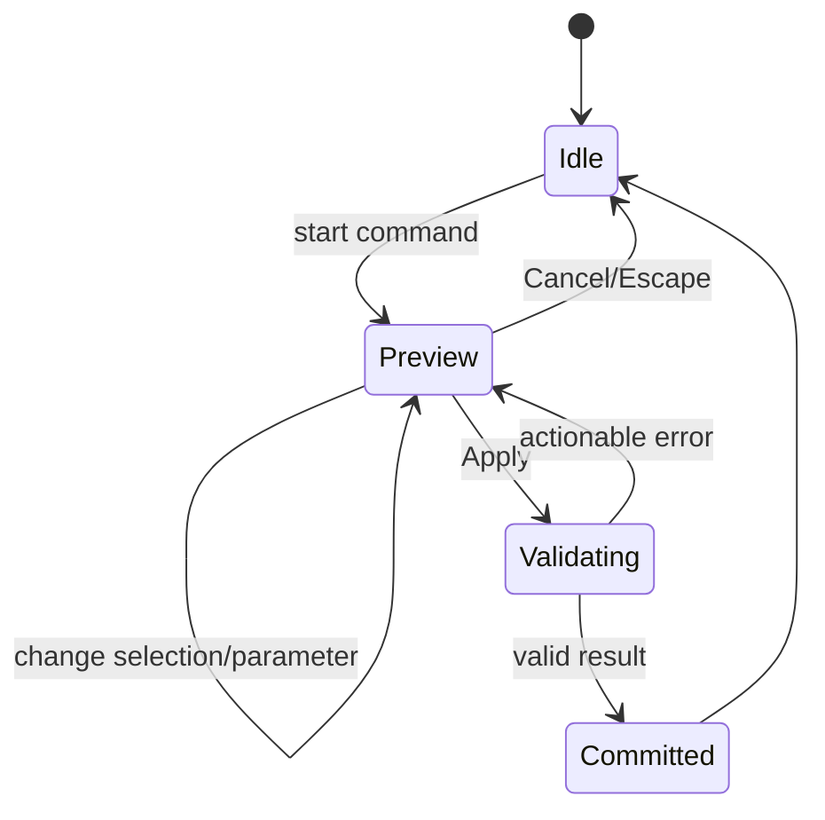

# UX and core flows

The cross-product interaction, visual, accessibility, and content rules are defined in [Design and UX Guidelines](design-and-ux-guidelines.md). This document defines the application frame and canonical end-to-end flows; the guidelines define how every state in those flows behaves.

## Interface frame

Desktop Model workspace layout:

```text
┌────────────────────────────────────────────────────────────────────┐
│ Project · Save state · Undo/Redo · Command palette · Export        │
├──────────────┬───────────────────────────────────┬─────────────────┤
│ Model tree   │                                   │ Properties /    │
│              │            Viewport               │ active command  │
│ Sketches     │                                   │                 │
│ Parts        │                                   │ Parameters      │
│ Bodies       │                                   │ Diagnostics     │
├──────────────┴───────────────────────────────────┴─────────────────┤
│ History: ordered feature icons · edit point · Details             │
├────────────────────────────────────────────────────────────────────┤
│ Status: units · selection filter · solver/rebuild · warnings       │
└────────────────────────────────────────────────────────────────────┘
```

In sketch mode, the right panel shows constraints and dimensions while the viewport preserves the current camera, orbit, pan, and zoom. Normal to sketch explicitly aligns the view to the support plane. Orbit 3D view and its standard-view menu preserve sketch editing on the same support plane, including in isometric view. Primary input draws or selects, middle drag orbits, secondary drag pans, and wheel zooms. A near-edge-on plane requires a different viewing angle before placement; Normal to sketch is the explicit return path. In print mode, the model tree remains visible and the right panel becomes the analysis and export report.

The browser heading shows the current project name. Variables remain directly accessible; Planes discloses XY/XZ/YZ and authored datum-plane selection and visibility controls. Parts, bodies, and sketches have distinct icons and counts. Empty Sketches offers the existing Create sketch command; its eye controls are grouped with sketches instead of masquerading as global model visibility.

Each local project has a canonical `?project=<document UUID>` address. An explicit URL takes precedence over the last project preference. New/open/import and automation project switches update the address; reload and browser Back/Forward use the same guarded project transition. Active edits, saves, and AI work block navigation without losing their draft, and the address is restored to the actual project on rejection. Invalid IDs and missing local projects show a recoverable error rather than creating another project under that address. These URLs identify IndexedDB projects in the same browser profile; they are not cloud sharing links. Other query parameters and the hash are preserved.

The shell uses Tailwind CSS v4 and source-owned shadcn/Radix primitives from `@vibeshape/ui`. Toolbar, command palette, menu, and shortcut invoke the same application command. The model tree and viewport overlays remain specialized accessible CAD components rather than being forced into generic `Card` or `Table` components.

The implemented command surface composes stable localized presentation descriptors with trusted application handlers. One resolved eligibility result drives the toolbar, command palette, cursor-near sketch shortcuts, and keyboard path, so a command cannot be enabled in one surface and blocked in another. The application bar opens the palette, and `Ctrl/Cmd+K` opens or closes it even while a text control owns focus. Search matches localized labels and keywords, retains disabled commands with a visible unmet requirement, and ranks the six most recently invoked commands in local UI preference storage. Palette close restores focus to its trigger. During active sketch creation or editing, `S` opens a collision-aware non-modal icon toolbar at the latest canvas pointer position, or at the viewport center when no pointer position exists. It exposes a curated high-frequency subset of the same commands, keeps disabled profile features visible with their reason, restores focus on close, and contains no duplicate Finish or Cancel action. Single-letter sketch shortcuts run only outside text-entry and IME composition; `Escape` first closes the shortcut toolbar, then remains available to clear an in-progress placement before the global active-command cancellation handler runs.

The implemented viewport shows terminal authoritative meshes only after a successful document rebuild. Raw Three.js owns the canvas scene and GPU lifecycle outside React reconciliation; localized loading, empty, rebuild-failure, and WebGL2-unavailable states remain ordinary DOM overlays. It supports orthographic orbit, pan, pointer-centered zoom, responsive fit, shaded faces, derived feature edges, hover face preselection, and primary-click face selection. Hovering or keyboard-focusing a visible feature-tree row adds a cyan whole-feature preselection overlay, while activating the row opens edit and keeps an amber overlay on that exact feature until the task closes. These overlays use the feature's own rebuild result even when downstream operations consume it; an exact unsaved candidate mesh replaces the committed highlight during preview, and hidden features remain hidden. Whole-feature highlighting stays independent from transient face selection. XY, XZ, and YZ remain visible as translucent origin datums by default and each can be hidden independently through an icon-only, tooltip-labeled control. They are selectable only while choosing sketch support, so visible datums never block solid clicks. Independent terminal bodies use a stable display-only palette derived from their feature identities; merged or consumed features do not create a second body color. Primary drag and middle drag rotate, modifier-primary and secondary drag pan, and movement beyond the click threshold never activates a face or sketch plane. A camera-relative world-axis inset stays visible and updates during orbit without resetting the camera; its semantic X/Y/Z colors are paired with an accessible DOM legend. The selected feature and friendly face ordinal are mirrored into the DOM status bar, and an explicit canvas control clears face selection. Empty primary click and every geometry replacement clear transient face selection while preserving the current camera and any open-feature highlight. Fit runs once when the viewport is initialized and later only through the explicit user action. The icon-only camera menu exposes isometric and six orthographic standard views with localized labels and tooltips. Choosing one preserves the current orbit target and scale, and the same navigation remains available in sketch orbit mode. Fit frames the model, sketches, and print envelope independently of the ground grid and origin datums. Render-depth bounds include those visible decorations; the orthographic camera can retreat along its view direction to keep them in front of the near plane without changing screen position or scale. Rendered face IDs remain transient. Idle exact-edge selection works directly on visible CAD edges and through the status-bar Edges filter, and seeds Fillet or Chamfer; vertex selection, perspective mode and further selection filters remain open.

### Planes

New planes use the versioned angular contract in [ADR-0114](../adr/0114-versioned-angular-datum-planes.md).
Opening a legacy offset plane leaves its version unchanged. Applying an edit explicitly upgrades that
feature while preserving its identity; Cancel leaves it unchanged and Undo restores the prior version.

The model browser groups XY, XZ, YZ, and every authored datum plane under **Planes**. Creating a
datum plane expands this group; selecting, renaming, hiding, or deleting it uses the same feature
commands as History. The chronological History entry remains available independently. Hidden,
suppressed, and rolled-back planes retain the ordinary selection and visibility rules.

**Datum plane** accepts a signed offset and an angle from −360° to 360°, including angle variables.
The selected support-local X or Y axis passes through the offset origin. Offset follows the original
support normal, then positive rotation follows the right-hand rule. Create and edit share exact
preview, validation, one-command Apply, Cancel, Undo/Redo, and native-file persistence. Existing
offset-only planes keep their original frames. Changing an already referenced plane's orientation
can leave an oriented sketch support unresolved; use explicit support repair rather than silently
retargeting it.

## Native Jev connection

**Agent → Jev (TypeSafe)** is a distinct bundled native adapter, with TypeSafe model/key settings
and a separate optional argument-model endpoint, model and key. It does not ask for an executable
or source path. Provider keys are connection-only and kept in host memory per project for the app
session; only non-secret settings persist. Recovery reuses the same project's cached keys, never
keys entered in another project. The form explains the difference between selecting CAD actions
and completing their open parameters. Connection and session settings open in an **AI settings**
modal; closing it preserves the current form and connection. PNG/JPEG images are enabled on native
Jev connections, including previously saved configurations, without a separate opt-in. The composer
shows Jev's four-image limit and rejects unsupported formats or images exceeding its combined
512 KiB base64 envelope before sending or queueing a turn. Captured views use the same admission.
**Test connection** checks TypeSafe and any configured argument model without sending project data,
images or CAD requests. Other ACP adapters receive an explicitly labelled initialization-only check.
Invalid or incomplete settings do
not start a process, repeated connection activation is blocked, and connection failure releases
the form for correction. Password fields clear only after the current connection is accepted as
ready; rejected, blocked or superseded attempts retain both keys for retry. Existing native chat
Stop, questions, transcript and project authority
remain authoritative. Browser-only chat cannot spawn this process.

## Assistant transcript

Human messages use a compact, right-aligned bubble distinct from assistant prose and tool rows.
Assistant prose renders CommonMark and GitHub Flavored Markdown, including emphasis, headings,
lists, links, fenced code and tables. Human text and tool details remain literal. Raw HTML is ignored,
unsafe URL schemes are blocked, and model-authored images display their alt text without fetching
remote content. Code blocks and tables scroll within the message rather than widening the panel.
The full display transcript is retained per project in IndexedDB rather than a truncated local
storage tail. Existing version-1 chat records are removed only after a successful transactional
migration. Persistence failures keep live messages, expose Retry chat storage and preserve the
previous saved transcript. Only display transcript text, validated tool metadata and attachment names are retained. File
bytes, credentials and raw provider payloads are excluded.

The API request context is separate from transcript storage. It retains complete conversational
turns within a 128 KiB UTF-8 budget, includes whitelisted tool display summaries, and excludes private
thoughts. An omitted-message count is visible when older messages are excluded from the request;
the complete saved conversation remains readable. This byte budget does not claim any provider's
token-window size.

An API failure retains available in-memory attachment content within that context budget. After
reopening a project, restored attachment turns explicitly mark their file contents as unavailable;
the assistant must request the files again before relying on them. Attachment-only turns therefore
remain meaningful context rather than becoming empty user messages.
Once a live turn starts, storage retries update display history without replacing its provider
context. Older messages recovered after that point remain readable and contribute to the visible
omitted count; reopening the project can restore them into the next bounded context.

Consecutive tool calls with the same title and status share one compact row with a count on the
right. A different action, status, or conversational message starts a new row, preserving order
and keeping failures visible. Groups with reported output stay collapsed by default; opening one
reveals each call's output in order within a bounded scrolling region. Empty output has no
disclosure. Streaming updates preserve the reader's transcript position when scrolled away from
the bottom.

When the agent supplies validated project-scoped object identities, hovering or focusing a tool
row highlights matching History entries, authored Parts or sketches, and currently visible geometry.
A group highlights the union; an expanded call highlights its own targets. Inspection never changes
selection, visibility, the camera, History position, or saved geometry. Older messages and providers
without structured identities remain readable without inferred links. Consumed construction Parts
are collapsed separately from the main Parts count; unavailable terminal Parts remain visible for
repair.

After a batch finishes, its available change controls stay above the chat composer, outside the
scrolling transcript, so they remain reachable while reading earlier messages. Buttons use icons
with tooltips and accessible names. An unsaved agent preview defaults to **Result**, using
normal model materials; **Changes** uses the blue preview material. Both remain disposable previews
without topology-picking authority. The caption explicitly distinguishes unsaved preview from saved
changes. A ready, owner-bound unsaved draft offers **Confirm changes** (the checkmark) in the chat;
it uses the existing commit and approval policy, stays pending through persistence, and reports failures without asking
the model to send another command. Saved batches expose **View before** / **View current** and **Undo agent changes** through
the existing internal checkpoint. These controls remain hidden while the agent is busy and do not
move the transcript when the person is reading earlier messages. Inspection locks do not open
connection settings, and control/display changes do not trigger transcript following without new
message content. The chat header contains the chat title, project name, and actions without a
working-status label. Hiding chat preserves its mounted transcript, draft,
attachment reads, scroll position, settings and active connection. The header AI chat toggle reopens
the same panel; show/hide and message updates do not resize or remount the viewport canvas.

Files can be dropped into the composer or chosen through Attach files. Both routes enforce the same
provider capabilities and per-file, count and total-byte limits. Unsupported files remain explicit
errors; dropping files never navigates away. A provider advertising image support also exposes
**Attach current view**. This explicit action renders the existing viewport at the current camera,
copies only its canvas pixels into a bounded PNG, and adds an ordinary removable attachment thumbnail.
The message field supplies its description. Capture never includes the surrounding UI, changes the
camera, or sends automatically. The direct browser API currently advertises text attachments only.
Queued-message steering uses a compact upper-right icon button with its full accessible name.

An interrupted embedded desktop connection shows automatic recovery progress for up to five attempts
per connection owner, followed by an explicit retry action. Recovery retains settings and the reading
position. A resumable provider session continues only after accepted writes settle and the agent
reconciles current model state; it does not resend the interrupted prompt. Continuation starts a new
internal checkpoint, so its Undo/View before controls cover its own saved changes. Stop, Disconnect
and permanent authentication or configuration failures require the person's action.

Failed calls retain the reported diagnostic in their expandable output. If the agent supplied no
error detail, the row says so explicitly instead of offering an empty disclosure.

The native and API queues retain accepted messages in FIFO order; later messages do not overwrite
older pending requests. Both assistant instruction contexts require successive requests to remain
additive unless the person explicitly cancels or replaces earlier work. The provider must reconcile
steering with active work and identify blocked requests before reporting completion; the application
cannot certify a language model's semantic fulfillment from delivery alone.

The embedded native and browser API assistants expose `ask_user_question` for a bounded non-secret
form. A required answer pauses dependent CAD work, queued delivery, steering and automatic recovery
continuation. A premature provider ready event cannot dismiss the form. A valid unexpired reply
releases the wait; dismissal, timeout, Stop or disconnection pauses the queue and grants no answer.
The API also stops later tool calls in the same response after an unanswered question is abandoned.
Native forms normally expire after five minutes and API forms after two; a provider may impose a
shorter MCP request timeout. The native tool uses a captured session/transport callback and does not
depend on provider-specific elicitation forwarding or questions inferred from prose.

During an active AI operation or review, a blocked durable visibility change can use the existing
project-local view override for inspection. A neutral status explicitly states that it was not
saved. Returning to the saved visibility clears that override without a metadata command. Idle
visibility changes still use ordinary durable metadata and Undo; stale, read-only and storage
failures retain their specific diagnostics.

## Application menu

The VibeShape menu groups global actions into Project (files, local projects, and geometry export),
Workspace (settings and command palette), AI (connection and session controls when available), and
Help (FAQ, MCP setup, and keyboard shortcuts). The header retains the project name, rename action,
save status, and the Model / Assembly mode switch. Mode selection stays above the command toolbar
and is unavailable while a feature or sketch is being edited or the document is saving.
The status bar exposes local **AI access** as an outlined button. It stays disabled with
the visible **MCP client not connected** explanation until a client is available. An active
local or remote AI session shows **AI access on**, its approval mode, and a direct outlined
**Stop AI** action. Stop AI revokes session access; it does not stop the development MCP
server. Auto-apply consent remains in the existing session dialog.

The FAQ's MCP page offers a copyable server URL and agent setup prompt. In development it derives
`/mcp` from the current editor origin only when the local bridge marker is present. Its instructions
use Streamable HTTP without authentication and explicit **AI access** approval. Production and
preview do not infer an HTTP endpoint from a stdio editor marker; a configured remote endpoint
retains its OAuth and pairing-code instructions.

The menu supports arrow-key navigation, typeahead, Enter, and Escape. Opening a dialog preserves
its existing guards and pending behavior; dismissing it closes the menu and returns focus to the
VibeShape trigger. Palette and shortcut help also return focus to that persistent trigger.

## Command states

Every modeling command uses the same state machine:



- Preview does not modify the document and may use low-quality temporary tessellation.
- Apply creates one domain transaction and one undo entry.
- An error preserves parameters and the failing selection.
- Escape always cancels the active command before the document changes.

Subtract offers current solid outputs when creating a feature and retains both saved inputs when
editing. **Keep tool solid** leaves the selected tool available alongside the subtraction result;
the default consumes it from the final model. Both choices retain the tool feature and dependency
in History for subsequent edits. Retention changes body and authored-part consumption, not the
cut geometry or its cached content identity. Suppression, deletion, and Undo restore source bodies.

During sketch editing, the adjacent **Intersection** icon switches the orbitable 3D viewer into planar-face preselection. One eligible face creates an exact bounded read-only line on the active sketch plane and returns to Select. Parallel or coplanar faces are rejected before draft mutation, while exact OCCT failures remain fail-closed.

Each compatible external-reference row exposes **Replace reference**. Activating it reuses the canvas-first Use broker, limits normal and orbit candidates to a compatible topology kind, and marks the action as pressed. Live model-backed candidates stay within the same producing feature. A reference intentionally orphaned by source-feature deletion may instead target compatible topology from another visible feature and becomes an ordinary live reference after the pick. Sketch-backed candidates may come from any earlier sketch, but a curve must retain both its source and projected analytical types. Picking one candidate preserves the reference ID, projected entity IDs, metadata, and dependent constraints, then returns to Select. Finishing and reopening the sketch retains the friendly source-and-geometry label for the replacement. Activating the pressed action again cancels repair without changing the draft.

Deleting or changing referenced geometry in an earlier sketch is a valid semantic edit. The dependent reference remains persisted as unresolved intent instead of being discarded or silently redirected. The same applies when current rebuilt model geometry can no longer materialize a referenced vertex, edge, curve, or planar intersection. Before the dependent is opened, its History row shows a non-color repair status with separate direct and chained failure counts; the adjacent alert action names the affected sketch and opens it directly for repair. Opening the dependent sketch shows a non-color **Broken external reference** indicator and a specific label such as `Sketch 1 · Missing line`. Replace exposes only compatible earlier-sketch geometry directly in the viewport; one graphical pick repairs the source while retaining local projected identities and constraints. Deleting the entire source sketch retains its dependents with disconnected repair intent; Undo restores the source and its references.

**Replace support** beside the current support leaves the sketch editor for the existing 3D support picker without discarding the draft. The replacement-specific overlay accepts an earlier origin plane, Datum Plane, or supported planar model face; later History items are rolled back and unavailable. Cancel restores the exact edit session. One accepted pick returns directly to Select, preserves all authored geometry and constraint identities, records one local undo step, and persists through Finish and reopen. Changing the support moves unchanged local sketch coordinates into the new world frame; incompatible projections remain unresolved and fail closed. Activating **Intersect planar face** from normal view similarly opens the orbitable 3D face picker immediately, displays the required one-face instruction, and never leaves the command armed without a selectable canvas target. Normal Select names each visible eligible earlier-sketch or projected-model candidate on hover or keyboard focus and accepts it directly as a stable read-only reference. Activating **Use external geometry** keeps the same analytical canvas and graphical broker active as a persistent projection mode for repeated selection and repair.

The Box and Cylinder create/edit slices implement idle → disposable preview → validate → persisted commit with preserved field errors and asynchronous single-flight submission. Each direct primitive exposes explicit signed X, Y, and Z placement-origin fields beside its dimensions; these fields use the project display unit, accept supported unit literals and committed `#variables`, and default legacy records to the world origin. A world-space translation gizmo appears at the candidate origin in both create and edit tasks. Dragging one of its X, Y, or Z handles updates the exact task-panel fields and the debounced preview without publishing a document revision; React-facing updates are limited to the latest position per animation frame, Orbit controls are suspended for the gesture, and releasing a handle does not select an underlying face. `Escape`, pointer cancellation, capture loss, or window blur restores the drag-start origin and camera interaction without discarding unrelated form edits. Direct manipulation replaces each changed origin expression with an explicit literal in the current project unit while preserving dimensions, centered state, feature identity, and every untouched record field. Apply publishes one ordinary add or update command, while Cancel discards the candidate. Box width and depth remain centered on the placement origin. Cylinder radius remains centered on its placement axis. A non-centered height starts at placement Z, while centered height extends equally above and below it. Activating either primitive in the feature tree opens the same task-panel form with all authored source expressions, not only resolved millimeter values. Arbitrary primitive rotation, scaling, screen-plane translation, and numeric drag snapping remain later interaction work.

For distance extents, Extrude create and edit expose a one-axis 3D depth manipulator through the primary selected profile’s area centroid, using the existing sampled region including its holes. This mathematical center can lie inside a hole or outside a concave region. The anchor follows its actual support frame; Start offset shifts it along the original support normal independently of Reverse. Multiple profiles share the authored distance while the primary profile supplies the displayed handle and direction; unrelated support normals are not averaged. Reversed changes the primary direction. Second direction adds an independently authored opposite depth; First depth and Second depth in the viewport choose the endpoint controlled by the single arrow, and dragging changes only that endpoint’s field. An axis viewed directly along its direction has no usable screen-space drag, so the viewer explains how to use an angled view or the exact distance field. Dragging it writes an explicit literal in the current project length unit into the same TanStack Form distance field and updates the disposable exact preview without creating a document revision. The task-panel field remains the precise keyboard and expression path; editing it moves the handle continuously. Symmetric Extrude keeps the authored field as total depth while each visual half extends by half that value. The viewer owns only the disposable world-space handle, latest-frame pointer sampling, orbit suspension, and drag cancellation; the editor session owns the transient scalar request, and the form remains the parameter authority. A valid preview acknowledges the request so a later field or `#variable` edit is never shadowed by stale drag state. A temporary pending preview preserves the active pointer gesture. Escape, capture loss, pointer cancellation, or window blur restores the drag-start depth while retaining the task. Closing the task cancels the gesture and releases pointer capture immediately. Cancel discards both preview and handle, while Apply emits one ordinary feature command. The fixed-depth handle is hidden for Through all, Up to body and Up to face, whose target geometry determines the extent. Returning to Distance restores the authored numeric depth and its handle.

Revolve create and edit expose a curved angular manipulator around the selected analytical axis. Its start and end radial lines make the swept sector explicit, and the arrow endpoint is the only pointer drag target. The radius is derived from the selected profile's farthest outer-loop point, while the axis origin is the closest point on the infinite selected axis; renderer samples never become document authority. Dragging publishes at most the latest angle per animation frame, writes a readable explicit literal in the active project angle unit into the same TanStack Form field, and drives the disposable exact preview. A full turn remains exactly 360 degrees or `2π` radians instead of being rounded outside the accepted range. Orbit is suspended only for the drag; `Escape`, pointer cancellation, capture loss, or window blur restores the drag-start angle. A valid preview acknowledges the transient Zustand request so later field or `#variable` edits remain authoritative. Cancel removes the arc without changing the document, while Apply emits one ordinary feature command.

Revolve accepts one canonical same-sketch profile selector set, one exact origin, sketch-line, or model-edge axis, an angle expression, and operation intent. Multi-profile New preserves its bounded multi-solid result and remains unavailable as a downstream Boolean target. Multi-profile Add, Remove, and Intersect combine the revolved tools before one target Boolean, require exactly one positive-volume solid, and remain target-eligible. A modifying record orders the target dependency first, the distinct sketch-support owner next, and the distinct model-edge axis owner last. Create and edit keep the complete selector set, shared axis, operation, target, and authored expression through preview, Apply, reopen, and subsequent downstream selection.

Hole starts from a finished sketch containing explicit points and one eligible solid target. The
non-modal task panel lists centers as checkboxes and offers the same stable IDs through graphical
and keyboard viewport selection. A second click toggles a point. Diameter and blind depth accept
unit-aware expressions; through-all has no authored depth and cuts only in the selected direction
from the sketch plane. Changing a semantic value immediately invalidates the old preview. Apply
requires the latest valid exact result, prevents duplicate submission, and creates one ordinary
undo step. Cancel releases the candidate and selection context. During a document save, the form
and picking are unavailable. Missing sketch, body, or point intent remains visible for explicit
repair; switching sketches clears the old center selection. Edit, native reopen, and MCP use the
same feature record, target/support dependencies, and source point identities.

The implemented sketch-editor slice follows idle → support selection → transient authoring → live solve → persisted commit. The idle workspace keeps the task panel hidden; `Create sketch` is directly available in the toolbar, and primitive solids remain available in their modeling group. `Create sketch` first keeps the 3D modeling viewport active, shows the XY, XZ, and YZ origin planes as translucent selectable datums, and mirrors hover preselection and the current choice into localized DOM status. Primary click accepts an origin plane or an eligible planar model face; an eligible model face takes priority where it overlaps a displayed origin plane, so an extrusion cap can be selected directly. Face hover names the exact `Feature · Face N`; overlapping model faces open a bounded Select Other list with visual preview, forward/reverse cycling, keyboard acceptance, and cancellation instead of silently choosing mesh insertion order. The accepted stable topology support retains the same resolved label in the disabled support control after Finish and reopen. Compact origin-plane buttons provide the keyboard alternative without replacing canvas selection. When a supported planar model face is already selected, `Create sketch` skips the redundant confirmation and enters the editor immediately with a stable face support. Only then does the application enter the orthographic 2D workspace with a validated, unsaved sketch draft. The active sketch plane and two perpendicular origin references remain visible as non-interactive SVG datum references and retain the same independent visibility controls as the 3D viewport. The Radix contextual toolbar then replaces unrelated solid commands with separate direct Extrude and Revolve commands, Select, Point, **Dimension**, **Use external geometry**, Construction, local Undo/Redo, direct analytical Trim/Extend/Split/Mirror/Offset, and split tool families for Line/Midpoint Line, corner/Center/Aligned/Centered Aligned Rectangle, center-point/three-point Circle and Center-point Ellipse, Inscribed/Circumscribed Polygon, three-point/Tangent/center-point Arc, and Straight/Centered/selection-driven Slot. Use external geometry projects compatible earlier sketch points, lines, circles, arcs, ellipses, and elliptical arcs into the active drawing and exposes their source geometry in the persistent orbitable 3D context; clicking either representation creates the same read-only reference. If normal-view candidates overlap at the pointer, a compact non-modal chooser lists deterministic source labels and creates only the selected stable reference; `Escape` dismisses it without changing the draft. A selected local point can receive Coincident against an external point, Point on curve against an external round curve, an exact Point on ellipse relation against a full ellipse, or an exact bounded Point on elliptical arc relation; mixed local/external selections can drive compatible relations and dimensions without making referenced geometry editable or part of the active profile. External-only driving dimensions are not offered. Ellipse centers, axis points, quadrants, the complete full-ellipse locus, and the positive elliptical-arc sweep are stable reference targets. The primary family icon invokes the active or last-used variant, while the adjacent radio menu exposes every variant and standard shortcut. The toolbar uses one tab stop and arrow-key navigation, identifies the active tool, and prevents switching back to Model until the draft is finished or canceled. Dimension uses `D`; one click selects a line or round curve, while sequential clicks collect two points or two lines without a modifier. A compatible selection previews witness leaders at the pointer, a placement click opens a variable-aware inline editor beside the annotation, and `Enter` commits one stable driving constraint. Pointer position disambiguates direct, horizontal, and vertical point distances; compact inline choices resolve round and ellipse-axis ambiguity. Double-click edits an existing value in place, label drag changes only presentation state, and staged `Escape` closes input, clears references, then exits Dimension. Applying an edited value closes both the canvas editor and any selected task-panel fallback; reopening reads the committed draft value. The task-panel form remains an accessible fallback and never receives focus automatically. Points cannot be dragged while Dimension is active. Corner Rectangle uses `G`; Center Rectangle uses `R`; center-point Circle uses `C`; Three-point Arc uses `A`; Tangent Arc uses `Shift+A`; Trim uses `M`; and Offset uses `O`, matching the corresponding Onshape shortcuts. Midpoint Line mirrors one endpoint around the first pick and stores the midpoint relation; Aligned Rectangle uses two picks for its first side and a third for signed perpendicular width; Centered Aligned Rectangle uses a center, symmetric half-axis, and perpendicular half-width; Three-point Circle accepts three circumference points and stores their point-on-curve relations; Center-point Ellipse accepts a center, first-axis endpoint, and perpendicular second-axis radius and stores three stable points around one analytical curve; Circumscribed and Inscribed Polygon use center, radius/apothem, and a pointer-derived or typed 3–50 side count while persisting exact equal-side and construction-circle intent; Tangent Arc starts from an existing line endpoint, stores tangent intent, then returns to Line; Straight Slot uses two centerline picks plus width; Centered Slot mirrors the centerline around the first center pick; and Slot from selected line is available only for exactly one selected line and needs one width pick. Trim removes the clicked line, arc, or circle portion between bounded analytical neighbors. Extend moves the clicked-near line or arc endpoint to the nearest reachable line, arc, or circle. Split divides a line or arc at one projected click; a circle accepts two projected clicks and previews complementary equal-radius arcs before committing. Mirror either reflects a preselection after one axis-line pick and returns to Select, or accepts the axis first, highlights it, and mirrors repeated point or curve picks until `Escape`; localized status copy names the active step. Offset accepts a line preselection or one canvas line, expands a valid clicked component, previews the signed mitered result, and commits the complete line chain as one editable dimension; `Escape` cancels only the distance step and keeps the tool active. Each completed tool or modification is one local history edit. The task panel retains support and a collapsed Constraint manager for accessible or diagnostic constraint and dimension editing; closed profiles stay canvas-selected, and one compact Cancel/Finish pair remains anchored in its command header while the property area scrolls independently. The manager opens only from the dedicated diagnostic action in the contextual Sketch toolbar; solver conflicts remain visible in the canvas and solve summary before it is opened, keeping canvas annotations and the contextual precision toolbar as the primary workflow. Analytical tools call shared domain operations; Select supports additive entity selection; points drag directly; Delete removes selected geometry with dependent constraints; middle or secondary drag pans; `Shift` suppresses automatic inference; and wheel zooms toward the pointer.

Creation-time precision now keeps the common geometry path on the canvas without forcing a form into the pointer workflow. Dimensionable Line, Rectangle, Circle, Arc, Ellipse, Slot, and regular Polygon families commit valid geometry immediately and show a compact anchored exact-value affordance without moving focus. Continued pointer input remains active, including line-chain and tangent-arc continuation. Clicking the affordance opens the shared variable-aware editor for length, width, height, diameter, radius, or authored axis diameters. Straight and Centered Slot use center-to-center length followed by total width; Slot from selected line offers only its newly authored width. Polygon side count remains an exact, non-blocking 3–50 keyboard input during placement, followed by optional radius refinement after commit. Enter commits an accepted dimension by replacing the geometry draft checkpoint, so one local Undo removes the complete creation gesture. Escape keeps the valid geometry undimensioned.

The Dimension editor defaults to Driving and exposes Reference for distance, horizontal distance, vertical distance, angle, radius, and diameter. Reference mode hides the expression field, persists no value, adds no solver equation, and renders the current solved measurement as a parenthesized dashed annotation. A reference annotation remains selectable and draggable but has no expression editor. Finish and reopen preserve the reference identity and recompute its displayed value from live solved geometry.

The normal-view overlap chooser uses the same keyboard grammar as the orbitable 3D broker. Grave accent and Shift+grave accent cycle the active analytical preselection, `Enter` creates only the highlighted stable reference, and `Escape` dismisses the chooser without changing the draft.

Elliptical Arc belongs to the Arc family and follows four picks: center, primary-axis endpoint, secondary-radius/start point, and endpoint. The third and fourth stages show a temporary construction ellipse; the completed entity is one exact analytical curve and one local history edit. Compatible selections promote the complete [mandatory sketch precision toolset](sketch-toolset.md): coincident, horizontal, vertical, parallel, perpendicular, equal, tangent, concentric, midpoint, symmetric, fixed, point-on-line, and point-on-curve constraints plus distance, projected-distance, signed Offset, angle, radius, round diameter, and stable primary- and secondary-axis diameter dimensions. Selecting one point and one full ellipse or elliptical arc exposes **Point on curve** and persists the corresponding exact full or positive-sweep bounded locus. Ellipse-axis dimensions use authored axis names rather than derived major/minor names, remain valid if the secondary axis becomes longer, and place their drawing labels at separate axis endpoints. Only actions that consume the complete current selection appear in the compact icon-only viewport toolbar and accessible task-panel equivalent. Applied glyphs are selectable on the drawing; selecting a driving dimension opens the same stable constraint in the expression editor. Dimension expressions accept units and committed `#variables`; typing `#` opens the same caret-aware variable autocomplete used by feature parameters and the Variables table, while the constraint list preserves authored text and allows explicit removal. Every non-drag draft change requests a debounced document protocol v18 SolveSpace solve without creating a document revision. Point drag reuses a prepared spatial inference index and one viewport-rectangle snapshot, reduces raw pointer input to the latest animation-frame sample, and renders the active point plus incident curves immediately in a local overlay. Ordinary drafts stream exact feedback through a bounded 32 ms throttle. Dense drafts debounce exact feedback until a 120 ms pointer pause, and very dense drafts stay entirely on the local preview path until release. The scheduler sends the unchanged schema-valid sketch plus a separate target, retains at most one solve in flight and the latest pending target, and forwards continuation state. This preserves exact dependent-geometry feedback where it fits the interaction budget without reintroducing whole-sketch cloning, Zod parsing, layout reads, or unrelated curve rerenders during continuous dense motion. Pointer release preserves the final overlay, publishes exactly one global draft and undo entry including an accepted inferred relation, and requests the final exact solve. The fixed-height CAD shell keeps long constraint lists in an internal task-panel scroller, so heavy sketches cannot resize the canvas. The canvas reports solver status and degrees of freedom, renders closed regions behind exact entity strokes, and derives stable boundary selectors for profile activation. An empty draft reports that geometry has not been authored instead of presenting a misleading fully constrained solver state.

In Select, the compatible precision toolbar is anchored beside the selected geometry rather than detached in a viewport corner. Secondary activation opens a labeled context menu for the same eligible constraints, Dimension flow, and Delete behavior. A hit on an already selected entity uses the complete current selection; a hit on an unselected entity uses that explicit target without changing selection merely because the menu opened. The main command toolbar and command palette expose the same constraints as one remembered split family. Choosing a family member starts an Onshape-style repeatable tool: compatible canvas picks are collected in either order, one constraint is committed when the selection is complete, and the tool stays active for the next application. The first `Escape` clears a partial selection; the next exits the tool. A complete selection made before activation is consumed immediately. Every action remains available through the visible toolbar, task panel, or keyboard path, so the context menu is never the sole entry point.

`Finish sketch` is asynchronous and single-flight, creates one ordinary add or update revision, and cannot be double-submitted. Finishing an unchanged saved sketch is treated as a successful no-op: it returns to Model without publishing a false save failure or creating a revision. Success returns directly to the Model workspace, preserves the selected closed profile for downstream features, and renders the saved sketch with the rest of the model on its exact support frame. After reload or when another sketch is active, hovering a visible saved region highlights it with a readable Sketch · Profile label; clicking it selects the canonical boundary selector without entering sketch edit, and enables the shared profile-feature commands. Its model-tree visibility action hides or restores only this derived reference display. Cancel discards the draft. Activating a saved sketch immediately enters edit mode and restores every stable entity, constraint, and expression identity; there is no redundant intermediate `Edit sketch` action. Component and browser harnesses prove a real WebGL2 origin-plane pick, the keyboard-equivalent plane path, distinct XY/XZ/YZ visibility symbols, shared model/sketch datum visibility, exact saved-sketch 3D projection and independent visibility, variable-driven dimension refactor, fully constrained solve, grouped family selection, exact Center-point Ellipse placement and OCCT extrusion, exact four-pick Elliptical Arc authoring and history, center, aligned, and centered-aligned rectangles, midpoint line, three-point circle, both regular polygon variants with typed side count, three-point arc, tangent arc, straight slot, centered slot, selected-line slot preview/intent/history, atomic line/arc/circle/ellipse/elliptical-arc Trim and Split plus open line/arc/elliptical-arc Extend with Undo and exact SolveSpace feedback, both Mirror selection orders, connected-line Offset preview/history and signed-dimension reversal through the real solver, responsive physical endpoint drag with at least 96 lines and streamed dependent-geometry feedback, edit, save, reload, profile selection, extrusion, command-palette creation, and shortcut-driven sketch-tool selection. Idle-viewport preselection-first sketch entry, additional inference modes, round and ellipse boundaries for ellipse modification, spline and curve-chain modification, the remaining command-registry shortcuts, command-level document undo, and bounded conflict-repair suggestions remain follow-up interaction work. The delivery sequence is tracked in the [Editor experience implementation plan](editor-experience-plan.md).

An open Extrude or Revolve task keeps its profile as task-local draft intent and leaves visible saved regions selectable in the 3D viewport. Hover preselects the exact region, primary click or the synchronized keyboard picker replaces the draft selector, and the preview and `Sketch · Profile N` status update without closing or resetting the parameter form. The task panel lists every selected profile once, gives each selected row one removal action, and exposes clear-all only for a multi-profile selection. Apply persists the latest selector in the existing feature command; Cancel discards it. Selecting a profile from another supported sketch also replaces the feature's stable sketch-support reference. While editing an existing feature, sketches after that feature in the derived History are hidden from profile picking so the interaction cannot author a forward dependency. Revolve exposes profile and axis as two explicit graphical selection targets: its compact profile-field picker switches the viewport from axis candidates to saved profiles, one accepted profile returns focus to axis selection, same-sketch line axes are retained, and a line axis owned by another sketch resets visibly to origin X rather than being silently rebound. Below the desktop breakpoint, a new active task opens the same mounted parameter form as a bottom sheet over the viewport. Its labeled collapse control preserves buffered expressions, validation, preview state, and the compact Cancel/Apply actions while allowing the 3D view to be inspected at 200% browser zoom.

The first extrusion slice starts from one or more selected sketch profiles. Extrude is one registered command across the toolbar, command palette, and contextual surfaces; it carries the canonical selector set into a task panel that names the selected sketch and exposes operation, target, distance, and symmetric state. While a sketch is open, the Extrude icon remains available in the Sketch toolbar and first performs the ordinary sketch save. After Finish sketch, the same command consumes the retained selection; after reload, profiles can be selected directly from visible 3D regions. Primary click replaces the selection and `Shift`-click toggles another same-sketch region; the task panel provides removal and clear actions. The feature stores canonical boundary entity IDs, never displayed profile ordinals. Distance accepts the same unit-aware literals and committed `#variables` as other length fields. Valid parameter changes publish a debounced feature draft to an isolated document-worker session and render changed terminal bodies as an explicitly unsaved, non-selectable exact OCCT preview. Every draft change immediately invalidates the previous preview acknowledgement. Loading, invalid, and failed previews preserve the form buffer and committed viewport geometry while keeping Create or Update disabled; submission becomes available only after the exact worker acknowledges the latest candidate as ready. Cancel terminates and discards preview state. Asynchronous Create or Update is single-flight, persists one ordinary feature revision, and closes only after persistence and authoritative rebuild succeed. Activating the extrusion restores the exact distance expression, complete selector set, symmetric state, operation, and target. Multi-profile New may produce bounded multiple solids and cannot be a downstream target; multi-profile Add, Remove, and Intersect combine one tool and require one result solid, which remains target-eligible. Changing a referenced variable rebuilds the exact result without rewriting the authored expression. Deleting the source sketch retains the extrusion with missing-profile repair intent. The delivery order is defined in the [Sketch-first modeling implementation plan](sketch-first-modeling-plan.md).

Feature removal is available from its active edit task even when later History items depend on it. Eligibility uses the validated authoritative dependency graph; an invalid or incomplete dependency model still fails closed. The shared accessible `AlertDialog` names the feature, explains that affected inputs are disconnected while downstream operations are retained, blocks duplicate activation, and preserves an error after failed persistence. Successful removal closes the edit task, clears an invalid viewport selection, and updates terminal geometry. Undo restores the feature and its references; browser reload and native project files preserve repair intent. Lightweighting workspace tasks use the same save-before-navigation policy: only an exact ready result can be applied, while invalid, pending, or failed saves retain their task. Their source selection and imported result honor the History insertion boundary. Opening a retained body-based operation offers an explicit earlier-body selector while preserving parameter expressions and feature identity. Missing topology is reselected through the existing controls. A repaired sketch can remove all broken references and persist as an empty sketch; metadata-only rename or suppression preserves the saved repair recipe. Existing MCP removal tools retain their strict dependency-blocking contract.


Transform extends the direct analytical modify group. It accepts either an existing selection or
subsequent point and curve picks, then exposes a canvas manipulator for free move, sketch-axis move,
rotation, and positive uniform scale. Pointer movement updates only a selected-geometry SVG overlay;
it does not publish a draft, parse the complete sketch, or request a solve. `Shift` snaps rotation
and scale. `Enter` or an empty-canvas primary click applies one domain transform and one local undo
entry; `Escape` cancels it. The origin ring relocates the pivot without changing the current affine
preview and snaps to authored points within a screen-space tolerance. The exact-value panel accepts
origin, translation, rotation, and positive scale expressions, reuses project display units and
committed `#variables`, and applies through the same single draft edit.

Linear Pattern accepts the same preselection or post-selection grammar. Its TanStack Form panel
defines a required first direction and optional second direction; each direction has an integer
count including the seed, positive spacing, and angle. Length and angle fields normalize bare values
to project units and suggest committed `#variables`. The viewport renders at most ten total seed and
copy instances while editing, then one Apply materializes at most 100 total instances as one local
history edit. Shared points stay shared inside each occurrence, internal compatible constraints are
cloned, and crossing, fixed, or rotation-incompatible constraints are omitted. The copies are
independent after commit until associative pattern metadata is introduced.

Circular Pattern reuses that selection grammar and materialization boundary. Its TanStack Form
panel exposes a project-unit-aware center, an integer count including the seed, and either a closed
360° distribution or an open signed sweep below one full turn. Length and angle inputs accept
committed `#variables`. A center glyph remains visible with the bounded SVG copy preview. `Enter`,
empty canvas, or Apply commits at most 100 total instances as one local history edit; `Escape`
cancels. Shared seed points and compatible internal constraints are cloned per occurrence, with
orientation intent retained only for exact quarter turns. Copies remain independent, and dragging
the center directly on the canvas remains open until associative pattern metadata is introduced.

Ordered Use chains remain graphical: a later sketch can select projected geometry owned by an intermediate sketch, not only that sketch's authored entities. The direct intermediate owner remains visible in labels and stable identity, while compatible edits to the original source recursively update the downstream projection after solve, save, and reopen.

## Flow 1: create a printable part

An open sketch with at least one closed profile exposes separate direct Extrude and Revolve icon commands in the Sketch toolbar, while both registered commands remain independently searchable in the command palette. The sketch task header contains only the compact Cancel/Finish pair; the contextual Sketch toolbar owns the separate diagnostic-tools action and never duplicates profile-feature commands. Either feature command captures every current closed profile in canonical order, performs the same single-flight, revision-checked sketch add or update as `Finish sketch`, then opens the ordinary multi-profile feature task only after persistence succeeds. The task initially highlights every captured region and allows individual regions to be removed or restored; a stale revision or storage failure preserves the complete draft. This follows Onshape's direct open-sketch feature path. Finishing the sketch, selecting a visible profile, and then invoking the same feature command remains an equivalent workflow without introducing a separate Fusion-style modeling mode. Once a document contains a saved sketch, idle Extrude and Revolve commands remain available without preselection, including after reopening the project. A matching current profile is preserved; otherwise the command opens its existing profile-selection task and waits for an explicit closed profile before enabling preview and Apply. The saved-profile picker includes previously used profiles even when their sketch is hidden; picking one preserves the sketch’s visibility and excludes dependency-ineligible sketches. A selected model face is identified separately from a closed sketch profile. Extrude explains the distinction and, for a supported planar face, offers the existing Create sketch on selected face action. An unfinished sketch without a closed profile still blocks these commands.

1. Create a project and choose a printer profile or no profile.
2. Select an origin plane and create a sketch.
3. Draw geometry, apply constraints, and reach a clear solver state.
4. Finish the sketch and extrude it.
5. Add feature-tree operations; preview changes before commit.
6. Open Print Check for units, solid validity, mesh validity, dimensions, overhang, and wall warnings.
7. Export 3MF and optionally STEP or STL.

The application-level `Export…` dialog selects one destination, one file format, and one primary action. Save file starts with the preferred format and All parts; STEP uses exact solids, while STL and 3MF expose mesh quality. Export remains disabled until the committed rebuilt revision contains eligible geometry. Direct Open in slicer is a desktop-only STL/3MF handoff to a registered installed or explicitly chosen application. The browser explains this boundary and uses Save file for downloads. No local HTTP bridge or automatic fallback download is used. Prepare print stays a secondary disposable-copy workflow for All parts. Assembly Export similarly selects one format and exports the selected or all frozen poses; closing cancels its owned work and suppresses late output. Pending actions keep their original names and locks, while only the application wordmark displays a loader. Native backup, geometry download, slicer handoff, and printing remain distinct operations.

Projects opens the full-page local project library rather than a modal. A project card's thumbnail and name share one keyboard-accessible open target; sibling rename, duplicate, and confirmed delete actions do not activate it. Empty previews show an origin grid instead of an unavailable-preview error. The same VibeShape application menu offers Settings and FAQ on the library and editor. Save project (.vshape) directly downloads an editable backup from the editor menu. The icon-only Rename action beside the current project identity uses the shared revision-checked form; inactive library rows are not renamed implicitly. Successful rename updates identity, tabs, backups, and geometry filenames without changing the project ID.

Settings contains the project display-unit form alongside browser appearance, workspace, and export preferences. Length offers `um`, `mm`, `cm`, `m`, `in`, and `ft`; angle offers `deg` and `rad`. Apply dispatches one revision-checked `org.vibeshape.document.set-display-units` command and is single-flight. Success immediately converts derived results, profile measurements, orientation labels, status, and new dimensional-field defaults while leaving geometry and authored expressions unchanged. A bare numeric literal entered into a known length or angle field is persisted with the active unit explicitly. Reload and `.vshape` round-trip preserve the preference; read-only documents expose it without permitting a semantic change.

The visible File control owns both the local-project library and the native-file flow. Save project (.vshape) and Open project (.vshape) appear first, and the introductory copy distinguishes automatic browser saving from an editable project file and STEP/STL/3MF exchange. Saving downloads replay-proven `.vshape` v6 even without exportable solids because complete semantic History, variables, sketches, formulas, and features are the payload. Opening verifies native formats v0 through v6, lifts older complete journals to the current persistence boundary, replays it under fresh document, command, and transaction identities, appends a bounded localized imported-copy name, and switches only after atomic publication succeeds. It preserves feature and variable identities, History anchors, and authored expressions inside the new document. It never replaces an existing local project or changes the source file. Checkpoint archives remain exportable, but opening one as a writable copy is explicitly refused. Native download, New project, and local/file opening are disabled with adjacent guidance while sketch or feature drafts, persistence work or errors, or AI operations/reviews are active. Mere idle pairing does not block them. File reads and preparation recheck the active document and revision after asynchronous work and before download or activation; a changed project keeps its current selection. The library strictly reads bounded authoritative summaries from both IndexedDB generations, marks the current project, and shows each name, semantic revision, localized modification time, and exact-revision isometric preview. Missing, stale, or unavailable geometry receives a labeled placeholder. New project and local Open are single-flight, release the current writer lease before navigation, and retain the current selection on pre-switch validation failure. Complete legacy history is promoted only under this tab's lease; contention or lossy recovery remains read-only. Duplicate publishes an inactive replay-verified copy under fresh identities and a bounded localized copy name without changing the current selection or marking an external backup; preview copying is non-authoritative best effort. Delete remains limited to an explicitly confirmed inactive project and atomically removes both generations of heads, events, snapshots, previews, recovery markers, and expired lease. Stale revisions or live leases leave its confirmation open with an error. Active-project deletion, explicit same-ID restoration, backup reminders, and system-picker enhancement remain later work.

Settings is one accessible modal with a scrollable body and visible Done action. Appearance selects Dark, Light, or System; Dark preserves the existing default, and System follows OS changes only while selected. Workspace reuses bounded panel width, opacity, show/hide, and reset controls plus browser-wide automatic consumed-sketch hiding, enabled by default. Project units retain their revision-checked Apply, validation, pending lock, and error recovery; an active editing/save/AI guard disables semantic unit changes while appearance remains available. Export preferences remember 3MF, STEP, or STL, with 3MF as the default, and display that format first in Export. Browser preferences use validated bounded local storage, recover safe defaults from corrupt or unavailable storage, and do not change authored geometry or grant export, printing, or AI authority. Camera alignment remains an explicit viewport action. Below 640px, the model tree is a closed-by-default temporary overlay opened with Show model tree above the task sheet; the task form and viewport use the full width. The tree and form stay mounted, and desktop width/collapse preferences are restored at wider sizes.

Saved sketches expose Rename and Delete in the left Sketches folder; the bottom feature timeline offers the same sketch actions and feature actions through an ellipsis menu. Compact timeline controls appear on hover or keyboard focus; Details keeps labels, visibility controls, source links, and dependency summaries visible. Focusing either tree item and pressing `F2` opens the identical dialog, so pointer and keyboard paths cannot diverge. A feature rename updates only its label through the ordinary revisioned feature-update command; a sketch rename updates only its label through the ordinary revisioned sketch-update command. Stable IDs, parameters, geometry, dependencies, and references remain unchanged. The currently edited sketch disables Rename until Finish or Cancel because committing its earlier draft would otherwise restore a stale label. Read-only documents disable all semantic rename actions with an explanatory tooltip. Validation, asynchronous locking, stale-revision recovery, and persistence-failure behavior are shared with project Rename. Every feature History row also separates transient eye visibility from persisted Suppress/Unsuppress intent. Suppression is available from the same actions menu with a pause/play icon and commits exactly one revision, participates in downstream rebuild and document undo/redo, disables meaningless visibility toggling while suppressed, and keeps the row present with muted, struck-through presentation so it can always be restored. Every History row can be dragged by its label or non-interactive surface, without a separate grip. Ordinary clicks still open the item, and nested action buttons never start dragging. Reordering uses pointer and touch dragging only, through the existing History command. Left/Right navigate the horizontal timeline, Up/Down navigate disclosure groups, Enter opens the item, and F2 renames it. Moves are disabled while another task or move is active, in read-only mode, or when the selected position would place a dependency after its consumer. Cancelled, stale, and rejected drags leave the canonical order unchanged. An accepted move records stable item-and-anchor intent as one versioned event, rebuilds once, participates in document undo/redo, and retains the exact interleaving after reload; feature and sketch storage-array order remains irrelevant.

## Flow 2: edit an early parameter

Sphere, Cone, Torus, and Pyramid use the same direct-primitive create/edit workflow as Box and Cylinder.
Sphere's origin is its center. Cone's base lies at origin Z unless centered height is enabled;
its apex points along positive Z. Torus uses a Z axis through its center, with major radius measured
to the tube center and minor radius measuring the tube itself. The minor radius must be smaller
than the major radius. Dimensions and placement accept unit expressions and committed variables;
preview remains disposable until Apply, and reopening restores authored expressions.
Pyramid defaults to four base sides and accepts integers from 3 to 64; its radius measures from the
base center to a vertex, with the first vertex along +X and the apex along +Z. Centered height and
placement follow Cone.
The model toolbar keeps Create sketch, Extrude, and Revolve directly accessible. Create, Modify, Primitives, and Inspect groups retain every other registered modeling command, its icon, shortcut, active state, and disabled explanation. When a group's menu has one remaining command, it becomes a direct icon. Responsive fitting measures that icon and preserves focus and one invocation path while commands move between direct controls and menus. Selected-part actions remain a separate group. Idle workspaces omit the introductory task panel and give its space to the viewport; selecting a saved sketch or starting a task restores its parameters without changing panel preferences.
Undo and Redo occupy a separate History block that remains visible while the command area scrolls.

The left browser contains Parts, unmanaged terminal Bodies, and Sketches; it does not duplicate the feature sequence. The bottom History strip scrolls horizontally and can collapse without closing a task. Its Details toggle exposes rich metadata. Hovering a feature preselects its geometry, while viewport body/face selection highlights its owning operation. **Find in browser** selects and reveals an available terminal result, including reopening a collapsed browser or object group. Consumed, suppressed, unavailable, or rolled-back outputs do not advertise that action. The divider and compact transport show the current History position; no insertion alert obscures the workspace. Layout changes preserve the mounted viewport, camera, active form, and document revision.

1. Activate a feature in the bottom History timeline or a dimension in the viewport.
2. Enter a new value and show a debounced preview.
3. Rebuild in the worker while keeping the UI responsive.
4. Commit atomically on success.
5. If a `TopoRef` is ambiguous, highlight affected downstream operations and present a bounded candidate set.
6. Save the repaired reference as part of the command.

The current Box, Cylinder, and Extrusion implementations cover tree activation, raw parameter restoration, validation, atomic update, worker rebuild, and reload persistence. Direct Box and Cylinder create/edit tasks add debounced exact geometry preview plus a world-axis origin translation gizmo paired with their exact X/Y/Z fields. Extrusion additionally proves stable profile intent across variable-driven sketch and distance rebuilds plus debounced exact create/edit preview without a document revision. Primitive rotation and scaling, multi-region modifying feature input, and broader topology-reference repair remain later interaction increments.

## Flow 3: import STEP as context

1. Choose Import → STEP; parse locally.
2. Before commit, show file size, units or assumptions, body count, and healing diagnostics.
3. Create an `ImportedBRepFeature`; let the user embed the source or keep an explicit external reference.
4. Measure the import and build a mating body around it.
5. Replace an external source only through an explicit Replace Source command; never reload it silently.

## Flow 4: crash recovery

1. Compare the latest exported version, snapshot, and autosave journal.
2. If the journal is newer than the clean-close marker, show its time and latest commands.
3. Restore into a new recovery snapshot; do not overwrite the original immediately.
4. Let the user save, compare, or discard the recovery state.

## Errors

Errors are classified as:

- **Input error** — invalid number, unit, or selection; corrected inside the active command.
- **Solver conflict** — show the smallest known conflicting set.
- **Kernel failure** — name the operation and suggest geometry-aware actions such as reducing a fillet, removing a tangent edge, or changing order.
- **Topology ambiguity** — show candidates and prohibit silent substitution.
- **Resource failure** — quota, memory, or worker crash; offer recovery export and worker restart.
- **Format error** — identify the file location, resource limit, or unsupported entity without executing file content.

Raw stack traces belong in a local diagnostic bundle but never replace a user-facing explanation.

Error wording, persistence, focus behavior, and recovery actions follow the [feedback and diagnostics rules](design-and-ux-guidelines.md#feedback-progress-and-diagnostics).

## Alpha keyboard shortcuts

| Action | Shortcut |
|---|---|
| Command palette | `Ctrl/Cmd+K` |
| Sketch shortcut toolbar | `S` while creating or editing a sketch |
| Undo / redo | `Ctrl/Cmd+Z`, `Ctrl/Cmd+Shift+Z` |
| Shortcut help | `F1` or the keyboard icon; searchable and generated from registered bindings |
| Create sketch | `Shift+S` |
| Extrude / revolve | `E` / `Shift+E`, when an eligible profile is available |
| Measure | `Shift+M`, outside sketch editing |
| Select / point / line | `V` / `P` / `L` in sketch editing |
| Rectangle / center rectangle | `G` / `R` in sketch editing |
| Circle / arc / tangent arc | `C` / `A` / `Shift+A` in sketch editing |
| Trim / dimension / offset / construction | `M` / `D` / `O` / `X` in sketch editing |
| Use external geometry / mirror | `U` / `I` in sketch editing |
| Normal to sketch / orbit sketch | `N` / `Shift+N` |
| Toggle all sketch visibility | `Shift+H` |
| Delete selected sketch geometry | `Delete/Backspace`, guarded during text input |
| Rename sketch or feature | `F2` on the focused History item |
| Cancel command | `Escape` |

The registered keymap is authoritative. Native backup/export, Fit view, and standard views currently
use their named controls, not global shortcuts. Enter submits only the focused form or confirms a
local interaction that advertises it; it is not a blanket Apply command. `O` means sketch Offset,
not projection mode. Configurable bindings remain a follow-up. macOS labels use `Cmd`; Windows and
Linux labels use `Ctrl`.

The complete shortcut safety, toolbar navigation, escape hierarchy, and canvas-accessibility contract is defined in [Design and UX Guidelines](design-and-ux-guidelines.md#accessibility-contract).

### Associative editing context

Orbit-view **Use external geometry** resolves pointer overlap through a closest-first Select Other stack.
Grave accent cycles forward, Shift+grave accent cycles backward, Enter or pointer activation accepts the
highlighted source, and Escape closes the overlay without changing the draft. Cycling changes only transient
viewer preselection; the committed reference continues to store stable source identity rather than a renderer ID.
After acceptance, the task panel resolves that stable identity against the current rebuild and keeps the same
localized feature-and-subshape label after save, rebuild, feature rename, and sketch reopen. Missing or ambiguous
topology remains explicit; internal semantic roles, lineage tokens, candidate IDs, and feature UUIDs are never
display labels.

The current camera is a local view preference independent of model and sketch History. Creating, reopening, finishing, cancelling, or replacing the support of a sketch preserves the current orientation, target, and zoom, including an isometric view. New sketch sessions use the current camera projection and map drawing input back to their own support plane; an edge-on or unavailable support remains explicitly unavailable for drawing. Only an explicit **Normal to sketch**, standard-view, or **Fit view** command changes the camera. Undo, redo, and geometry rebuilds do not restore a historical view.

Visible earlier sketches remain in the normal drawing as muted points, lines, circles, arcs, ellipses, and elliptical arcs, while the mounted 3D context preserves their spatial relation to the model. Ordinary projected geometry uses solid strokes and construction geometry uses reduced-emphasis dashed strokes. The analytical drawing is the sole rendering owner for every earlier sketch it projects in normal mode; the mounted Three.js scene continues to render upstream bodies but omits those saved-sketch displays, so circles, points, and curves cannot appear twice. Orbit mode hides the analytical drawing and restores the same earlier sketches to Three.js alongside one current unsaved solved draft. Returning normal restores analytical ownership without changing the draft or camera session. The model-tree eye action controls the same source in both views. **Use external geometry** makes compatible earlier points, lines, and analytical curves hit-testable without painting every candidate over the drawing. The muted source remains visible, and only the candidate under pointer preselection or keyboard focus receives an amber overlay before activation. Stable references recursively resolve solved upstream intent and use exact affine curve projection across non-degenerate supports; a circle can therefore remain a circle or become an ellipse as required by the target frame. While Point or Line is active, visible earlier-sketch and uniquely resolved coplanar model points, lines, and analytical curves wake directly under the pointer with an amber source highlight, source label, and compatible inference preview. Dragging an existing authored point uses the same passive candidate set, including midpoint, point-on-line, quadrant, and exact full or bounded ellipse relations. Hover and pointer motion remain disposable; release atomically materializes one stable read-only reference, moves the authored point, and adds the inferred constraint as one sketch-local edit. `Shift` suppresses wake-up and other suggestions for the current pointer sample. The candidate query is prepared outside pointer motion and returns only nearby analytical geometry, so dragging does not scan every visible curve per frame. A committed read-only reference then joins ordinary local inference without becoming editable and replaces its source candidate, so one source curve never appears as duplicate geometry. Non-coplanar projection and unsupported topology remain explicit **Use** workflows. Center points use fixed-screen crosshairs.

**Pierce to external line** is selection-first: exactly one authored point must be selected before the icon
becomes available. Activating it keeps the same sketch draft, opens the persistent orbitable 3D context, and
shows only visible earlier-sketch finite lines and stable linear model edges that cross the active support
transversely. Hover and keyboard focus name the source as `Sketch · Line` or `Feature · Edge`; one pick creates
a stable read-only Pierce point and Coincident, returns to Select, and preserves both identities through Finish
and reopen. A model-backed Pierce stores only its stable edge `TopoRef` and projected point identity; rebuilds
recompute the crossing from current exact edge geometry, while missing or ambiguous edges enter the ordinary
reference-repair flow. Parallel, coplanar, degenerate, or outside-segment candidates are not offered. Normal to
sketch cancels the pending pick without mutation.

**Text** opens a parameter dialog inside the active sketch. The bundled immutable font generates exact
line and cubic outlines in the current sketch frame; capital height, origin and spacing use explicit
millimeters. Apply creates one sketch Undo step, while Cancel discards preparation. **Text groups**
restore saved intent for editing, warn before replacing manually changed outlines, and require explicit
removal of attached constraints. **Detach to curves** keeps geometry and constraints while removing
editable text metadata. Native Save/Open retains group ownership and font binding; ordinary profile
validation governs extrusion. See [Editable sketch text](editable-sketch-text.md) for supported text
and regeneration behavior.

In Select mode, a committed projected point, line, or compatible analytical curve joins the ordinary
canvas multi-selection. Selecting it together with authored geometry exposes only relations that the
solver can apply while keeping the projected entity fixed. Projected-only selections expose no mutating
constraint or driving-dimension actions. Applied external relations retain their link treatment in the
canvas and constraint list, survive Finish and reopen, and resolve again from the stable source after an
upstream edit.

A new unsaved sketch treats every committed sketch as earlier context. Editing an existing sketch keeps only the committed sketches before it in document order, so a draft cannot create a forward reference to itself or a later sketch.

Editing a sketch rolls the viewport back at its History row by hiding its committed display and every later sketch or feature, including independent later items. Terminal bodies are derived again from the remaining feature graph, which keeps the latest upstream body visible in both normal and orbit views even when a hidden downstream operation consumed it. Explicit model-tree visibility remains independent: hiding a body does not expose an older body state, and restoring it takes effect immediately while the sketch stays open.

**Show final result** temporarily restores the downstream result behind the editable draft when the rollback view lacks useful spatial context. If rollback removes every solid but a later visible result exists, a compact viewport notice explains the History boundary and exposes this action directly; it does not appear while any earlier solid remains available. A visible **Final result · display only** status distinguishes that presentation from the authoritative editing boundary. Downstream geometry never enters hover inference, selection, or **Use** candidate sets, and the preference resets when the sketch session closes.

Every active local inference highlights its exact source point or curve in the same amber
preselection language used by external wake-up, including both lines at an intersection and the
reference curve for parallel, perpendicular, or tangent intent. `Shift` clears the glyph, guide,
and source highlight together for the current pointer sample.

Accepted constraint and dimension annotations remain spatially anchored beside their geometry.
Each compact annotation has a localized hover tooltip and accessible action name; geometric
relations select on click, while driving dimensions keep double-click edit and direct label drag.
Hover or keyboard focus highlights every local or projected entity participating in that relation
without changing the actual sketch selection. `Delete` or `Backspace` on a focused annotation
removes that constraint directly while leaving its related geometry in place.

## Committed document undo and redo

The idle model toolbar and command palette expose Undo and Redo. They restore a prior saved
transaction as a new revision, save it atomically, and rebuild the model. Multi-command draft
commits are one undo step. A new semantic edit clears redo; failed saves remain retryable.
Active sketch editing keeps its own draft history and shortcuts. Feature tasks and pending
saves block committed navigation. Text fields retain native text undo.

Reopening or switching projects resets the available undo/redo stack while preserving the result
of every completed navigation. See [ADR-0039](../adr/0039-committed-document-undo.md) for bounds and
recovery behavior.

### Picking feature references in 3D

The target-body fields in Extrude, Revolve, Hole, Fillet and Chamfer, both Boolean inputs, and Extrude end-body/end-face fields expose direct viewport selection. Clicking the field value starts selection; the adjacent list remains the keyboard and unavailable-geometry fallback. Picking an Extrude end face can select a different eligible body in the same click and updates its exact output role, current source hash and stable face reference together. Transient mesh face IDs never enter authored parameters.

Only one field owns selection at a time. Committed eligible geometry is shown during selection; a dedicated face-only interaction mode filters hover and clicks without letting saved profiles or origin planes intercept the field's selection. Ordinary preview presentation, profile/axis selection and manipulators resume afterward without discarding form values. Hidden Parts and hidden source features stay unselectable, including historical edit inputs. Stale, failed, ambiguous or non-solid evidence is refused. Existing feature parsers and revision-checked commands remain authoritative. Arming a field focuses its control, including in browsers that do not focus buttons on pointer activation. Nested controls handle Escape first; the next Escape cancels reference selection and returns focus to its field, and a later Escape follows ordinary task cancellation. Closing the field/task, saving, changing document revision or rebuild evidence, or changing visibility invalidates its pending request.

## Variable table search

The variable table offers case-insensitive search by name or expression, including names prefixed
with `#`. Search changes only visible rows: evaluation, dependency checks and Apply retain the
complete draft table and every unsaved edit. Clear restores the complete table; adding a variable
reveals and focuses its row. Validation reveals invalid rows even when the current search would
hide them. Enter in the search field does not apply the table.

## Selected-edge treatments

Model toolbar categories use icon-only triggers with accessible names and tooltips: Create, Modify,
Primitives, and Inspect. Their menus retain text labels. A singleton group invokes its command
directly; compact Modeling actions retains the shared overflow menu.

In the idle 3D workspace, hovering near a visible exact model edge highlights and names that edge;
clicking it selects stable edge intent independently of face selection. Edges behind another surface,
outside the section, or on hidden/preview geometry do not intercept ordinary face or profile picking.
Keyboard edge selectors appear on keyboard focus; the overlapping-edge chooser provides explicit disambiguation.

New Fillet and Chamfer tasks start in Selected edges scope with viewport picking active and a visible
zero-selection count. A selected eligible body or face seeds its source body; an ineligible selected
source never falls back to an unrelated body. A face does not imply a particular boundary edge.
The idle status-bar Selection filter offers Edges, so an exact edge set can be selected before
opening either tool. Activation captures that body's exact output role and references before
clearing ordinary editor selection. All edges remains an explicit option, and editing preserves
the feature's authored scope.

The graphical pick field accepts another eligible body directly from its edge or face; switching
bodies clears incompatible selections rather than transferring them to congruent topology.
Keyboard choices are an explicit, paged fallback with at most 32 rows per page. Edges without display
polylines remain selectable by their exact references there. The live count, persistent hint, and
individually named Remove controls keep multiple selections visible and keyboard-removable. Clicking
a selected edge again removes it. Missing and ambiguous references require explicit repair before
Apply. Escape cancels the picker and restores its trigger focus. Closed circular rims use the same
reference path; periodic seams and unbuildable oversized treatments report actionable diagnostics.

Chamfer additionally accepts face targets and exposes equal distance, two distances, and distance
plus angle. Advanced records retain quantity expressions, Offset/Tangent measurement, tangent
propagation, global flip and per-edge direction overrides. Asymmetric edge targets require an
explicit side face; the exact worker preview validates incidence. Advanced geometry is limited to
proven planar supports. Equal-distance Offset additionally admits closed circular rims with one
planar and one cylindrical adjacent face; exact native incidence remains authoritative. Curved
Tangent, directional modes, open arcs and other curved support pairs remain unsupported. Simple
circular-rim treatments retain the existing version-2 path. Apply creates one ordinary committed edit, Cancel
discards the task, and Undo/Redo uses shared session history. Existing all-edge features retain
version-1 semantics, and explicit-edge features are not migrated automatically. See
[ADR-0040](../adr/0040-selected-edge-treatments.md),
[ADR-0118](../adr/0118-body-bound-directional-chamfer.md) and its bounded measurement extension,
[ADR-0121](../adr/0121-circular-offset-chamfer.md).


## Parts, folders, placement, and export

Export remembers the last file format and mesh quality in local application preferences across
dialog reopen and browser sessions. Original-model, assembly and print-preparation mesh controls
share the quality preference. A native slicer destination is restored only when native support is
available, without initiating an export or handoff. Part/instance scope and model-specific print
transforms remain transient so preferences never select stale geometry in another project.

The Parts group is separate from History and contains selection, Rename, and visibility controls. Selecting a visible, available current exact Part in the tree or selecting its body/face in the viewport reveals Place / align faces, Mirror, Shell, Split, Pattern, and Thread icons in the main Model toolbar. Tooltips and accessible names identify each command. Compound and Union icons appear with that selection when at least two eligible exact body outputs exist, including independent sibling outputs. Mesh, hidden, consumed, ambiguous, or historical selections do not expose these Part commands. Active feature and sketch tasks hide the contextual group; the shared command registry guards read-only and pending-save invocation and supplies the same actions to the command palette.

Placement accepts six unit-aware expressions and previews the resulting rigid transform. Its face-alignment calculator selects a planar face on the moving body and a planar face on a different current exact body through viewport picks or descriptive keyboard choices. Pick faces in viewport pauses the disposable transform preview so the committed moving face can be selected; Calculate face alignment or a manual transform edit resumes it. With no planar target, alignment controls are collapsed so ordinary numeric placement remains visible. It aligns face centroids and opposing normals by default, with a same-direction option and signed target-normal offset. Calculating fills the ordinary XYZ expressions; Create placement commits one numeric transform. This is a fixed placement, not an associative mate: changing the target later does not reposition the source. Missing, ambiguous, non-planar, or stale face evidence cannot calculate a transform. Editing its History row reopens the same feature; Cancel discards the preview and Undo restores the preceding saved transaction.

Compound and Union have separate actions. Choose an ordered list of two to eight current parts including independent sibling outputs from one producing feature. Compound preserves each part and its stable output slot when inputs are reordered. Union identifies the first selected part as the survivor and explains consumption of the remaining parts; disconnected solids cannot be accepted as one Union. Editing retains unresolved inputs for explicit repair and excludes new choices that would create dependency cycles.

Shell targets one selected part and offers Open cavity or Closed cavity. Open cavity requires one or more faces, selected by clicking in 3D or checking descriptive face rows; clicking a selected face restores it. Selected faces remain highlighted while the translucent source permits further picking during exact preview. Closed cavity removes no faces. Inward preserves the outer surface and outward preserves the inner surface. Version 2 retains uniquely identified openings after source edits; lost or ambiguous identities require explicit repair. An unresolved opening never becomes a closed cavity implicitly. Apply, Cancel, edit, Undo/Redo, native reopening, and export use ordinary part and history authority. See [ADR-0076](../adr/0076-closed-shells-and-durable-opening-identity.md).

Split targets one selected part and previews an exact plane cut with a signed offset. Version 2 accepts an authored Datum Plane, a stable planar face, or an explicit plane alongside origin planes. The negative side continues the source part and the positive side becomes independently owned. Plane changes retain the offset; the origin-plane midpoint button explicitly recenters it. Invalid or tangent cuts block Apply. See [Split body](split-body.md) for ownership, failure, edit, undo, export, and MCP behavior.

Loft and Sweep use saved solved sketch selectors in their task panels. Loft explicitly adds, removes, and orders two to twenty-four hole-free sections within a 2,000-curve aggregate budget and exposes ruled interpolation. Sweep selects one closed profile, authored line/arc path entities, and an explicit start point; its profile frame must already be normal to the path start tangent. Origin and datum planes author the source frames without hidden repositioning. Exact failed previews block Apply, while Cancel, edit, Undo/Redo, Save/Open, and selected-part STEP export share the ordinary lifecycle. See [Sweep and Loft](sweep-loft.md).

Pattern targets one selected part with Linear or Circular placement, explicit XYZ axis, and a variable-aware scalar count including the seed. Signed spacing or total angle and explicit circular center coordinates retain authored intent. The seed continues its source part and each additional instance owns a stable independent part. A full circle excludes its duplicate endpoint. Failed counts and extents block Apply; edit, count changes, Undo/Redo, reopen, and selected-instance placement/export use ordinary authority. See [Body Pattern](body-pattern.md).

Thread captures one selected part's exact current body and previews a custom external or internal 60-degree V groove. Core dimensions include radial clearance; advanced options expose an explicit XYZ axis/origin, handedness, scalar starts, phase and unthreaded axial allowances. Expressions retain their source intent. Invalid dimensions, missed bands and native failures block Apply. The result continues the same owned part; Cancel, edit, Undo/Redo, native Save/Open and selected-part export use the ordinary lifecycle. See [Modeled custom threads](modeled-threads.md).

Clicking a different History item saves the current feature or sketch before opening the chosen editor. Validation and persistence failures keep the current editor and draft open. Rapid clicks share one save and open the last selected item. Unchanged committed previews reuse their cached geometry; disposable preview rebuilds run one at a time and discard superseded pending requests.

A row's context menu offers **Insert above** and **Insert below**. The insertion boundary limits the viewport and input selectors to earlier History items while keeping the complete tree visible. Creating a feature or sketch commits it directly at that position in one Undo step. Inserting after a folder member extends that folder; inserting before its first member stays outside. **Return to the full model** saves an active edit and clears the insertion boundary.

**Delete** remains available when later History items use the selected item. It removes the selected item, retains downstream operations, and disconnects their affected inputs. A missing-reference status identifies operations that need repair. Opening one restores its authored parameters for selecting replacement inputs; successful repair can restore downstream operations whose original inputs become valid again. Undo restores the removed item and its references. The repair state survives browser reload and native Save/Open.

Ctrl/Cmd-click toggles individual History rows; Shift-click selects a contiguous range from the last selection anchor. A normal click establishes an anchor while opening the editor. With a row focused, Shift+Space establishes or extends a range without opening the editor. **Add selection to folder** is available beside History and in the selected rows' context menu, and asks only for a folder name. **New folder** also accepts an explicit first and last History item. Selection cannot create a folder across a gap or overlap another folder. A row's context menu can add the selection to an existing folder only when the combined membership remains contiguous and does not overlap another folder; no History items move. Folders show their member count and support expand/collapse, Rename, Edit items, and Ungroup. Collapse and selection are presentation state; saved names and contiguous membership are organizational metadata. Ungroup removes only the folder. It never deletes or reorders geometry. Part names, visibility, folders, and feature history survive native Save/Open as a fresh document copy.

Export scope chooses All parts or one named part, including hidden parts. STL exports the selected current solid; multipart 3MF retains names and positions. Opening Export resets the scope to All parts. Print preparation is available for All parts and creates a disposable print copy; it does not modify the authored model. A changed document or unavailable selected body produces an error instead of silently exporting another body.

Import inspects local STEP/BREP exact solids or STL/3MF triangle meshes in a detached read-only preview. STEP/BREP/STL require explicit known source units; 3MF uses declared units without an override. STEP units are converted by the reader, while BREP/STL scale once. Cancel publishes nothing. Apply atomically captures immutable source bytes, exact signatures or mesh source node keys, and independently owned Parts; stale inspection, reader failure and unreadable preview block it. Undo/Redo and portable Save/Open share ordinary authority. Exact imported Parts support Placement and STEP export. Mesh Parts support selection, metadata, print preparation and STL/3MF export; exact operations and Placement are disabled, and STEP explains that an exact solid is required. See [Source geometry imports](exact-source-imports.md).

The History transport moves to the start, steps backward or forward through the interleaved sketch
and feature order, and returns to the full model. A vertical divider moves directly across the operation track. Dragging previews its target position;
release navigates once. The focused divider also supports Left/Right and Home/End, with Escape to cancel. Navigation uses the same save/validation guard as
opening another History item. A rejected edit keeps its draft and cursor. Moving the insertion boundary
is transient: complete History and saved geometry authority remain intact, and navigation adds no Undo
checkpoint. New features created while rolled back are inserted at that boundary.

## Local UI plugins

**VibeShape → Plugins…** installs a local declarative package after capability review, invokes its
commands in an isolated calculator panel, and offers Disable/Remove. Reload retains installations
without opening a panel. See [UI plugins](ui-plugins.md) for the supported profile and limits.

## Assembly and reusable components

[Assembly workspace](assembly-workspace.md) describes frozen definitions, independently placed
occurrences, constraint-solved joint motion preview, exact interference and scoped STEP/STL/3MF export. The
[local component library](local-component-library.md) provides immutable local versions and explicit
copy/reference insertion, update and detach. These workflows use ordinary document History and
portable native source closure.

## Surface texture editing

Start Surface texture and choose the current body output. The task can scope a layer to the whole
body or selected faces, which become body-scoped semantic references. Choose a built-in pattern or
upload an image for local grayscale conversion, then adjust projection/axis, height, size, rotation,
offset, direction, inversion, boundary fade, and layer blending. Layers can be added, enabled, and removed within the four-layer feature limit; blending follows
their saved order. Original/relief comparison and mesh statistics describe
the disposable preview.

Paint starts an empty regional mask; Erase removes relief locally. Brush dabs retain model positions
and normals so the opposite surface is protected. Brush-mask Undo remains draft work until Apply.
A missing or ambiguous selected face requires a replacement; another body or a nearby face is never
chosen automatically. Resource or invalid-displacement errors preserve the reviewed settings.

Apply requires the current writable source revision and a ready enabled-layer preview, prevents
duplicate activation, and saves the complete reviewed collection in one transaction. Cancel discards
that draft. The first Apply adopts V3 authority atomically; one document Undo clears that application
without downgrading the document schema. Subsequent Undo/Redo restores layer settings, maps, and masks
with the authored model. Native Save/Open preserves editable layers in format 4. STL/3MF include the
derived relief, while STEP exports the exact source B-Rep. Digital preview and mesh checks do not
prove wall thickness, absence of global self-intersections, physical fit, or a successful print.

Browser Apply/reopen/export acceptance is pending at this revision; worker and native-format evidence
remain separate from that workflow and from physical printing.

### Sketch camera navigation

Dragging anywhere in the XYZ orientation inset rotates the camera even while a sketch or feature
tool is active. An intentional drag in a plane-normal sketch switches to the 3D camera without
editing geometry or losing pointer capture. Clicking an axis remains a standard-view shortcut.

The visible **Rotate view** toggle beside the viewport’s standard-view selector suspends sketch pointer
editing and gives primary-button drag to the 3D camera. The current unsaved sketch remains visible. Toggle it off, choose **Orbit 3D view** or
**Normal to sketch**, or select a sketch tool to resume editing. Navigation creates no document or
sketch undo entry. In Normal to sketch, Standard views and Fit remain disabled until Rotate view or
Orbit 3D view activates the 3D camera. Finish, Cancel, and a later sketch session restore ordinary
editing defaults.

Selecting a constraint in its manager highlights its associated geometry and points in the
viewport without replacing the current entity selection. Horizontal/vertical glyphs are revealed
for selected, hovered or focused related geometry or constraints, rather than continuously filling
the sketch. Linear dimensions use a straight dimension line with extension lines and terminal
ticks. Their label offsets follow current geometry, including an in-flight drag and oblique camera
projection; moving the text does not change the driving value or authored expression.

The **Section view** icon beside the standard-view selector opens enable, plane, offset, and flip
controls. Its accessible name and tooltip identify the icon, and its active state remains visible.
Drag the plane's viewport handle along its projected normal to change the same offset; numeric input
is the keyboard equivalent. Pointer capture prevents accidental orbiting, and Escape or pointer
cancellation restores the starting offset. Closed render meshes receive derived solid cut caps with
hole preservation. Open, nonmanifold, intersecting, or over-budget contours conservatively omit caps.
Sectioning changes no authored geometry, revision, or export. Closing the control panel returns focus
to its trigger. Starting Fillet, Chamfer, Shell, Hole or another orbitable reference-picking task
retains the active section. Reference points, curves and face candidates respect the same clipping
plane for display and hit testing. Normal 2D sketch presentation temporarily suppresses sectioning;
returning to the model restores its parameters.

## FDM tools

Choose **FDM tools** in Model, select a kind, and supply its exact target or independent-body dimensions. Web/Rib additionally selects saved sketch lines. The panel uses normal exact Preview/Apply and restores the same parameters when editing History. Calibration coupons and independent sleeves remain available without an existing solid. See [Editable FDM features](fdm-tools.md). Thread exposes metric diameter/pitch presets; ordinary, assembly, and print-copy STL/3MF export surfaces expose Default/Coarse/Fine mesh quality.

## Lightweighting tasks

The registered **Generative Design** toolbar/palette command opens the same source-bound task
workflow with a bounded alternative search instead of a single objective. The default form guides
source/material selection and graphical fixed/load faces with an explicit force, then starts one
70% retained-mass target. Generate stays visible in the footer with the blocking reason and a
next-step action. Advanced disclosures retain custom material properties, preservation and solver
settings, up to three mass targets, two extra catalog materials, and optional keep-out boxes.
FDM controls select **Without supports** or **Supports allowed**, model-axis build direction,
minimum feature size, layer height, and maximum overhang from vertical. Both policies enforce
minimum feature size; support-free additionally excludes unsupported results. Supports-allowed
reports area requiring support without generating it. Changing any FDM setting invalidates the study.
Generated candidates show actual mass, worst-case compliance, Pareto status, duplicate geometry,
unsupported area, unmet targets, and scenario failures. Candidate selection previews an existing analyzed mesh
without repeating FEM. Settings/source changes invalidate the entire study; Apply uses the same
renderer readiness, atomic import, source hiding, and Undo behavior. See
[the study contract](generative-design.md) for scope and limitations.

Structural and quick lightweighting use the toolbar **Modify** menu and the responsive right task
panel. The selected exact solid is prefilled. Structural inputs select support, load, and optional
preserved faces in the canvas; quick inputs select lattice cells and slider values. Required action
reasons remain visible in task forms, with accessible disclosure on compact toolbar controls.
The commands use distinct organic-branch and lattice-cell SVG icons. Quick generation displays
current sampling or validation-pass progress and offers **Cancel generation**. Selecting a saved
mesh result in History opens its captured-source panel with ordinary **Delete feature** confirmation,
dependency checks and Undo/Redo.
See [the canonical workflows](lightweighting.md) for preview, Apply, cancellation, and limitations.


## Shared interaction feedback

The complete VibeShape wordmark shows a printing shimmer without changing its text or dimensions while owned work is pending. Concurrent actions share this indicator; buttons, project tabs, panels, and dialogs keep their accessible pending states and action locks without local loaders. The upper bar stays fully visible. Reduced motion keeps a static highlighted wordmark. Projects and the editor use the same application-header component for activity and native chrome. It reserves traffic-light space only while the macOS window is windowed; native fullscreen releases the left inset and exiting fullscreen restores it, including when navigating between Projects and the editor.

Operational errors appear in a fixed notification region that does not change the shell or dialog layout. Messages persist until dismissed or their owning state clears; a new failed attempt may show the same message again. Notification dismissal preserves the active modal and its inputs. Field validation and required dependency decisions remain near their inputs. Icon-only controls have accessible names and bottom-positioned tooltips; directly labelled controls have no tooltip. Interactive labels do not start text selection, while text fields remain editable and selectable.

The left tree supports Shift range selection and Ctrl/Cmd toggle selection for authored parts, bodies, and sketches. Selection in the viewport projects back to the exact current authored owner. Tree and History hover show exact related outputs and their corresponding rows without changing selection or visibility. Delete and Backspace on focused tree or History items open one confirmation for the complete selection. Accepted feature/sketch removals use one atomic revision-checked transaction and one Undo entry; downstream items remain for repair. A part can map to its creating feature only when every sibling output owned by that feature is selected. Generated or ambiguous ownership is blocked rather than guessed. Text entry, IME, modified shortcuts, active editing tasks, and modal interactions do not trigger this deletion shortcut.

Variables opens a modal from its existing tree entry, retaining the model behind it and returning focus on close. Creating a sketch starts plane selection directly. Redundant Model/Sketch toolbar switches are omitted. Dragging the orientation inset orbits around the existing camera target; short axis clicks choose standard views. Cancellation restores ordinary navigation, and normal sketch-projection locks remain authoritative.

### Direct part manipulation

Placement exposes translation handles and an X/Y/Z rotation mode at the current draft pose. Split
shows the actual resolved cutting plane and a signed normal-offset handle. Both update the same
expression fields used by the forms; dragging replaces only that field with a literal in the current
display unit. Invalid or unavailable references hide the controls and block Apply. Cancel discards
the draft, while Apply keeps the ordinary single feature command and Undo boundary.

Repeated Placement drags retain the last exact unsaved pose during valid input debounce and the next
preview rebuild. The viewport does not return to committed geometry between gestures. Invalid input,
Cancel, a different feature, or a changed committed revision clears that retained presentation; pending
geometry never becomes a saved change or new topology authority.

The Model toolbar measures available space and shows frequent operation icons in separated groups.
Each group keeps its remaining commands in a menu; at narrow widths, one Modeling actions menu
keeps every operation reachable beside Undo/Redo. Sketch tool families keep their dedicated strip.
The idle viewport does not show a saved-profile chooser. Active Extrude/Revolve profile selection
exposes a compact native chooser with canonical eligible selectors, including hidden sketches. It
keeps keyboard focus, additive/removal selection and dependency exclusions; Revolve axis selection
hides it until the profile field is activated again.

Fit view and explicit sketch bounds replace the complete visible camera span and reset accumulated
wheel zoom. Ordinary wheel navigation, standard view changes and orientation-inset rotation preserve
the current framing; returning from a sketch does not multiply an old zoom into its new bounds.

Orbit captures the visible model or sketch bounds center for each gesture. Cursor zoom and panning
keep their framing while subsequent rotation retains that stable pivot. Free sketch orbit starts
with a fresh pointer anchor. Recovery links for invalid project URLs open the Projects page,
preserving the other URL state; choosing a saved card opens its explicit project identity.
